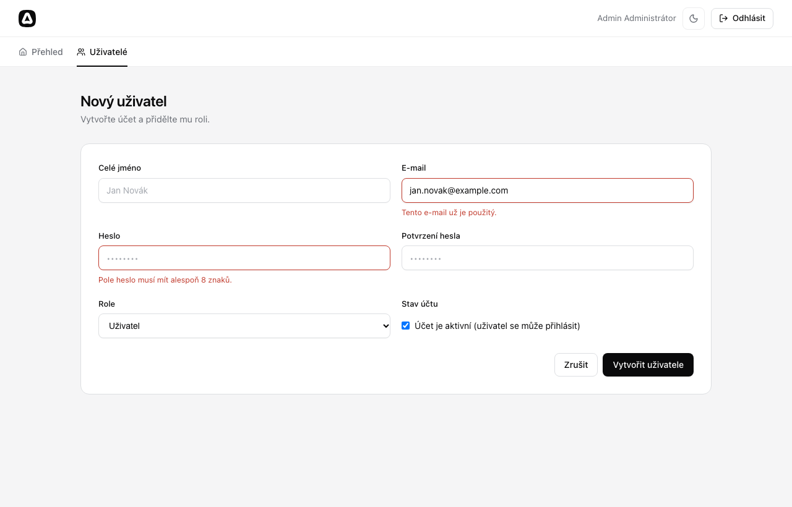
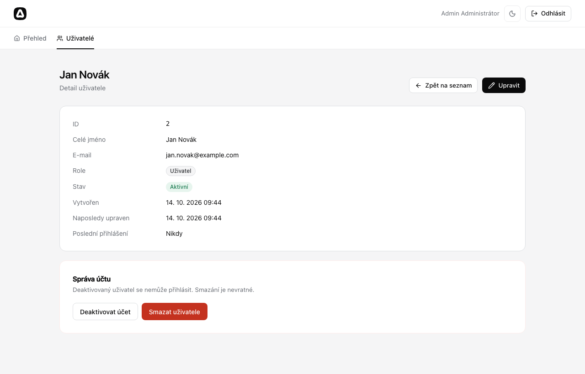
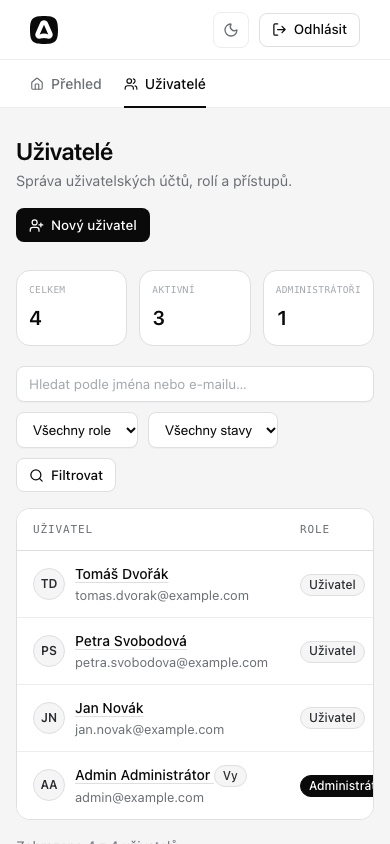

# AdonisJS: dojmy z práce, výhody, nevýhody a srovnání s Laravelem

Tento dokument popisuje zkušenosti s vývojem administrace uživatelů
ve frameworku **AdonisJS 7** (TypeScript, Node.js) nad databází **SQLite**
a srovnává AdonisJS s **Laravelem** a dalšími frameworky.

Postup instalace a popis funkcí je v [README.md](README.md).

---

## 1. Co je AdonisJS

AdonisJS je full-stack MVC framework pro Node.js psaný v TypeScriptu.
Často se mu říká „Laravel pro Node.js“, protože přebírá stejnou filozofii
„baterie v ceně“ (batteries included). Na rozdíl od minimalistického Expressu
dodává hotové řešení pro routing, ORM, migrace, validaci, autentizaci, session,
šablony, CSRF ochranu, CLI a testy, a to všechno od jednoho autora a se
společnou dokumentací.

| Oblast        | Balíček v AdonisJS                        | Ekvivalent v Laravelu           |
| ------------- | ----------------------------------------- | ------------------------------- |
| CLI           | `ace`                                     | `artisan`                       |
| ORM           | Lucid (Active Record nad Knex.js)         | Eloquent                        |
| Migrace       | Lucid migrations                          | Laravel migrations              |
| Validace      | VineJS                                    | Validator / Form Requests       |
| Šablony       | Edge                                      | Blade                           |
| Autentizace   | `@adonisjs/auth` (session, tokeny, basic) | Auth guards, Sanctum            |
| Autorizace    | Bouncer                                   | Gates a Policies                |
| Bezpečnost    | Shield (CSRF, CSP, HSTS)                  | VerifyCsrfToken middleware atd. |
| Testy         | Japa                                      | PHPUnit / Pest                  |
| Frontend      | Vite, volitelně Inertia (React/Vue)       | Vite, Inertia, Livewire         |
| IoC kontejner | ano, včetně dependency injection          | ano                             |

---

## 2. Co bylo vytvořeno

Výchozím bodem byl oficiální **web starter kit** (Edge šablony, session
autentizace, SQLite přes `better-sqlite3`). K němu přibylo:

- migrace přidávající sloupce `role`, `is_active` a `last_login_at`,
- seeder s administrátorem a demo uživateli,
- middleware `admin` a resource routy `/admin/users`,
- controller s výpisem (hledání, filtry, stránkování, statistiky), detailem,
  vytvořením, úpravou, (de)aktivací a smazáním,
- VineJS validátory s českými hláškami,
- Edge šablony administrace a CSS komponenty (tabulka, odznaky, stránkování),
- 12 funkčních testů v Japa.

Ukázky:

| Seznam uživatelů                             | Validace formuláře                                        |
| -------------------------------------------- | --------------------------------------------------------- |
|    |  |
| **Detail uživatele**                         | **Mobilní zobrazení**                                     |
|  |           |

---

## 3. Dojmy z práce

### Co potěšilo

**Rychlý start.** Starter kit obsahuje funkční registraci, přihlášení,
layout, formulářové komponenty a tmavý režim. Na začátku tedy nebylo nutné
řešit infrastrukturu a práce mohla začít rovnou na administraci.

**Struktura projektu je pro znalce Laravelu okamžitě srozumitelná.**
`app/controllers`, `app/models`, `app/middleware`, `database/migrations`,
`start/routes.ts`, `node ace make:migration`, `node ace db:seed`. Prakticky
každý pojem má v Laravelu přímý protějšek, takže se nebylo potřeba učit nový
způsob myšlení.

**TypeScript napříč celou aplikací.** Typově se kontroluje mnohem víc,
než je v PHP běžné:

- názvy rout: `response.redirect().toRoute('admin.users.index')` neprojde
  kompilací, pokud routa neexistuje,
- výstup validátoru: `request.validateUsing(createUserValidator)` vrací přesně
  typovaný objekt (`role` je `'admin' | 'user'`, ne libovolný řetězec),
- sloupce modelu.

Překlep v názvu routy nebo pole se tak projeví v editoru, ne až za běhu.

**Generování schématu modelu z databáze.** Lucid 22 po spuštění migrací
automaticky přegeneruje soubor `database/schema.ts` s třídou `UserSchema`
a model z ní pouze dědí. Sloupce se tedy nedeklarují ručně dvakrát (v migraci
a v modelu), což dřív v AdonisJS bylo nutné. Laravel to řeší dynamicky
(magické atributy), AdonisJS staticky s plnou typovou kontrolou.

**VineJS je příjemný a rychlý.** Pravidlo `unique` umí přímo dotaz do DB
včetně filtru (výjimka pro právě upravovaného uživatele přes `meta.userId`).
Nastavení českých hlášek pro celou aplikaci zabralo jeden soubor
(`start/validator.ts`).

**Testování je výborné.** Japa s pluginy pro session, auth a Shield umožňuje
psát testy jako:

```ts
await client.post('/admin/users').form({...}).withCsrfToken().loginAs(admin)
```

Každý test běží v globální transakci (`withGlobalTransaction`), která se vrátí
zpět. Celá sada 12 testů proběhne zhruba za sekundu.

**Edge šablony** jsou velmi podobné Blade (`@if`, `@each`, `@include`,
komponenty se sloty). Komponenty starter kitu (`@field.root`,
`@input.control`, `@!field.error()`) automaticky dosazují staré hodnoty
a chybové hlášky, takže formuláře mají málo boilerplate.

**Dev server s HMR** (`node ace serve --hmr`) aplikuje změny controllerů
bez restartu procesu.

### Na co se narazilo (zádrhely)

Následující problémy se skutečně objevily během vývoje. Žádný nebyl
zásadní, ale každý stál nějaký čas:

1. **Generované indexy controllerů a rout.** AdonisJS 7 generuje soubory
   `.adonisjs/server/controllers.ts` a `routes.d.ts`. Ty se ale aktualizují
   jen při běhu dev serveru (nebo `build`/`test`). Po vytvoření nového
   controlleru proto padal `node ace list:routes` i typová kontrola, dokud
   se nespustil `node ace serve`. Navíc se z podsložky `admin/` stal klíč
   `controllers.admin.Users` (malé „a“), což se dalo zjistit jen
   z vygenerovaného souboru.
2. **Pojmenování resource rout.** `router.resource('users', …).as('admin.users')`
   nevytvoří `admin.users.index`, ale `admin_users.index`. Správně je dát
   prefix názvu skupině: `router.group(…).prefix('admin').as('admin')`.
3. **Přeposílání query stringu při přesměrování.** Starter kit má
   v `config/app.ts` zapnuté `forwardQueryString: true`. Formuláře pro PUT
   a DELETE posílají `?_method=PUT` (method spoofing) a tento parametr se pak
   „přilepil“ k URL přesměrování (`/admin/users?_method=PUT`). Řešením je
   `response.redirect().withQs(false)`.
4. **SQLite a boolean.** SQLite ukládá boolean jako `0/1`. Vygenerované
   schéma sloupec typuje jako `boolean`, ale hodnota z DB je číslo. Bylo
   potřeba v modelu doplnit `@column({ consume: (v) => Boolean(v) })`.
   Laravel to řeší jedním řádkem v `$casts`.
5. **`nullable()` vs. `optional()` ve VineJS.** `nullable()` povolí `null`,
   ale chybějící pole stále hlásí „povinné“. Přišel na to až test, který
   pole `fullName` vůbec neposlal. Správně je `.nullable().optional()`.
6. **Hot-reload proces běží dál.** `node ace serve --hmr` spouští proces
   aplikace jako potomka. Po ukončení jen rodičovského příkazu zůstal port
   3333 obsazený a testy hlásily `EADDRINUSE`.
7. **Web starter kit neobsahuje API klienta pro testy.** Pro funkční testy
   bylo nutné doinstalovat `@japa/api-client` a zaregistrovat pluginy session,
   auth a shield v `tests/bootstrap.ts`.
8. **Chybí hotový admin panel.** V Laravelu by se základní CRUD nad uživateli
   dal mít během pár minut přes Filament nebo Nova. V AdonisJS takový zralý
   nástroj neexistuje, takže tabulka, filtry, stránkování a formuláře jsou
   psané ručně.

---

## 4. Výhody a nevýhody AdonisJS

### Výhody ✅

- **Ucelený framework:** ORM, validace, auth, session, CSRF, mail, testy, CLI
  a vše od jednoho týmu, se sjednoceným API a dokumentací. V Node.js
  ekosystému je to výjimka (Express/Fastify jsou jen HTTP vrstva).
- **TypeScript jako první volba:** typované routy, validátory, modely, IoC
  kontejner a konfigurace.
- **Velmi blízko Laravelu:** pro PHP vývojáře minimální křivka učení.
- **Výkon a asynchronní model Node.js:** jeden proces obslouží mnoho
  souběžných požadavků; vhodné i pro WebSockets a real-time (Transmit).
- **Jeden jazyk na frontendu i backendu**, snadné sdílení typů
  (hlavně s Inertia + React/Vue).
- **Kvalitní testovací nástroje** (Japa) a rychlé testy díky transakcím.
- **Moderní nástroje:** Vite, HMR, ESM, `node ace add <balíček>` sám nainstaluje
  a nakonfiguruje balíček.
- **Bezpečné výchozí nastavení:** CSRF, hashování hesel (výchozí scrypt, volitelně argon2/bcrypt),
  ochrana proti mass-assignment díky explicitním validátorům.

### Nevýhody ❌

- **Malý ekosystém a komunita** ve srovnání s Laravelem: méně balíčků, návodů,
  odpovědí na Stack Overflow a méně vývojářů na trhu práce.
- **Chybí hotové admin panely a starter kity** typu Filament, Nova, Jetstream
  a Spark. CRUD je potřeba psát ručně.
- **Rychlý vývoj = breaking changes.** Mezi verzemi 5, 6 a 7 se výrazně
  měnilo API. Řada návodů na internetu je pro starší verze a nefunguje.
- **Generované soubory a „magie“ buildu** (indexy controllerů, typy rout,
  schéma modelů) jsou pohodlné, ale je potřeba vědět, kdy a čím se generují.
- **Hosting:** aplikace potřebuje běžící Node.js proces (PM2, Docker, PaaS);
  levný sdílený PHP hosting nestačí.
- **Méně „syntaktického cukru“ než Eloquent** (casty, accessory, scopes jsou
  dostupné, ale upovídanější; např. boolean ze SQLite).
- **Dokumentace** je kvalitní, ale u pokročilých témat (generování schémat,
  pluginy pro testy) je stručná a je třeba číst zdrojový kód.

---

## 5. Srovnání s Laravelem

| Kritérium              | AdonisJS 7                                                | Laravel 12+                                             |
| ---------------------- | --------------------------------------------------------- | ------------------------------------------------------- |
| Jazyk                  | TypeScript (Node.js)                                      | PHP 8.x                                                 |
| Typová bezpečnost      | Vysoká (kompilátor, typované routy i validace)            | Střední (PHPStan/Larastan doplňkově)                    |
| ORM                    | Lucid: Active Record, Knex, generované schéma             | Eloquent: Active Record, velmi bohaté API               |
| Validace               | VineJS, typovaný výstup                                   | Validator, Form Requests, pravidla jako řetězce/objekty |
| Šablony                | Edge                                                      | Blade                                                   |
| Admin panel            | Není hotové řešení                                        | Filament, Nova, Backpack                                |
| Auth starter kity      | Starter kity (web, Inertia, API)                          | Breeze/Starter Kits, Jetstream, Fortify, Socialite      |
| Fronty, plánovač, mail | Mail vyzrálý, fronty v rané verzi (`@adonisjs/queue` 0.x) | Vestavěné a velmi vyzrálé (Horizon, Scheduler)          |
| Testy                  | Japa                                                      | PHPUnit / Pest, Dusk                                    |
| Real-time              | Transmit (SSE), WebSockets přes Node                      | Reverb, Echo, Broadcasting                              |
| Výkon                  | Asynchronní I/O, dlouho běžící proces                     | Proces na požadavek (nebo Octane)                       |
| Hosting                | Node proces, Docker, PaaS                                 | Cokoliv s PHP, Forge, Vapor, Cloud                      |
| Velikost komunity      | Malá až střední                                           | Velmi velká                                             |
| Křivka učení           | Nízká pro znalce Laravelu, střední pro ostatní            | Nízká, obrovské množství materiálů (Laracasts)          |

### Stejný kód v obou frameworcích

**Validace při vytvoření uživatele**

AdonisJS (VineJS):

```ts
export const createUserValidator = vine.create({
  fullName: vine.string().trim().maxLength(255).nullable().optional(),
  email: vine.string().trim().email().unique({ table: 'users', column: 'email' }),
  password: vine.string().minLength(8).confirmed({ as: 'passwordConfirmation' }),
  role: vine.enum(['admin', 'user']),
  isActive: vine.boolean().optional(),
})
```

Laravel (Form Request):

```php
public function rules(): array
{
    return [
        'full_name' => ['nullable', 'string', 'max:255'],
        'email'     => ['required', 'email', 'unique:users,email'],
        'password'  => ['required', 'min:8', 'confirmed'],
        'role'      => ['required', Rule::in(['admin', 'user'])],
        'is_active' => ['boolean'],
    ];
}
```

Laravel je stručnější, AdonisJS na oplátku vrací typovaný objekt
(`payload.role` má typ `'admin' | 'user'`).

**Routy**

```ts
// AdonisJS
router
  .group(() => {
    router.resource('users', controllers.admin.Users)
    router
      .post('users/:id/toggle-status', [controllers.admin.Users, 'toggleStatus'])
      .as('users.toggle_status')
  })
  .prefix('admin')
  .as('admin')
  .use([middleware.auth(), middleware.admin()])
```

```php
// Laravel
Route::middleware(['auth', 'admin'])->prefix('admin')->name('admin.')->group(function () {
    Route::resource('users', UserController::class);
    Route::post('users/{user}/toggle-status', [UserController::class, 'toggleStatus'])
        ->name('users.toggle_status');
});
```

Téměř 1:1. Laravel navíc umí _route model binding_ (`{user}` se automaticky
načte jako model). V AdonisJS se volá `User.findOrFail(params.id)` ručně.

**Dotaz s podmíněnými filtry**

```ts
// AdonisJS (Lucid)
User.query()
  .if(filters.role, (q) => q.where('role', filters.role!))
  .if(filters.status, (q) => q.where('is_active', filters.status === 'active'))
  .paginate(page, 10)
```

```php
// Laravel (Eloquent)
User::query()
    ->when($role, fn ($q) => $q->where('role', $role))
    ->when($status, fn ($q) => $q->where('is_active', $status === 'active'))
    ->paginate(10);
```

### Krátké srovnání s dalšími Node.js frameworky

- **Express / Fastify:** pouze HTTP vrstva. ORM (Prisma, TypeORM), validaci
  (Zod), auth (Passport) a strukturu projektu si musí vývojář poskládat sám.
  AdonisJS ušetří spoustu rozhodování a „lepení“.
- **NestJS:** také ucelený a typovaný, ale inspirovaný Angularem (moduly,
  dekorátory, DI všude). Hodí se spíš na API a mikroslužby, je upovídanější
  a nemá vlastní ORM ani šablony. AdonisJS je bližší klasickému MVC a lépe
  se hodí na server-rendered webové aplikace.
- **Next.js / Nuxt:** frontendové meta-frameworky se serverovými funkcemi,
  ne plnohodnotný backend s ORM, migracemi a frontami.

---

## 6. Závěr

AdonisJS splnil zadání bez problémů. Administrace uživatelů s rolemi,
filtry, stránkováním, validací, CSRF ochranou a testy vznikla relativně
rychle a kód je přehledný a typově bezpečný. Pro vývojáře znalého Laravelu
je přechod velmi snadný, protože koncepty i názvosloví jsou téměř stejné.

**Kdy zvolit AdonisJS:** tým preferuje TypeScript a jeden jazyk pro
frontend i backend, jde o real-time aplikaci, nebo chcete „Laravel
zkušenost“ v Node.js ekosystému.

**Kdy zvolit Laravel:** je potřeba rychle dodat aplikaci s administrací
(Filament/Nova), využít obrovský ekosystém balíčků, snadno najít vývojáře,
nebo nasadit na běžný PHP hosting.

Celkové hodnocení: AdonisJS je vyspělý a příjemný framework, který je ve
světě Node.js nejbližší Laravelu. Jeho hlavní slabinou není kvalita, ale
velikost ekosystému a komunity.
