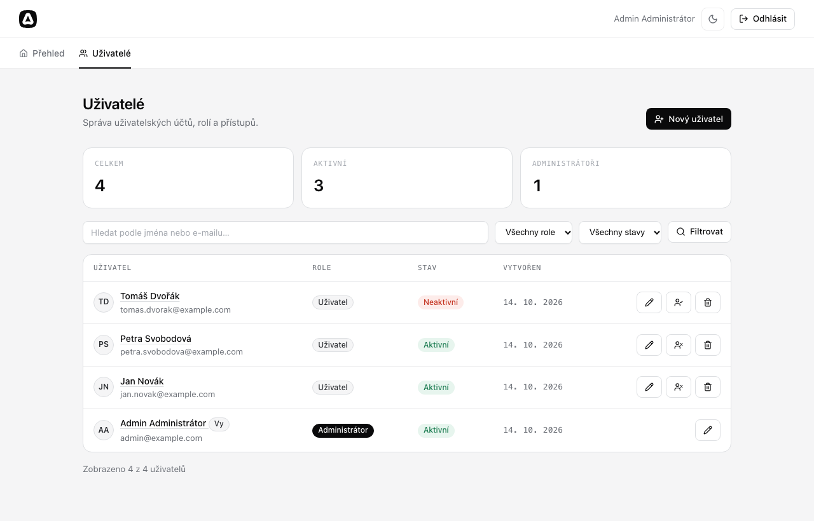

# Správa uživatelů v AdonisJS

Webová aplikace s administrací uživatelů postavená na frameworku
[AdonisJS 7](https://adonisjs.com) a databázi **SQLite**.

Hodnocení frameworku a srovnání s Laravelem najdete v souboru
**[DOKUMENTACE.md](DOKUMENTACE.md)**.



## Funkce

- Registrace, přihlášení a odhlášení (session guard, `@adonisjs/auth`)
- Role **administrátor** a **uživatel**; administrace je dostupná jen administrátorům
- Seznam uživatelů se statistikami, fulltextovým hledáním (jméno, e-mail),
  filtrem podle role a stavu a stránkováním
- Detail uživatele (vytvoření, poslední úprava, poslední přihlášení)
- Vytvoření a úprava uživatele včetně změny hesla (prázdné heslo = beze změny)
- Aktivace a deaktivace účtu. Deaktivovaný uživatel se nepřihlásí a ztratí
  i probíhající session.
- Smazání uživatele s potvrzením
- Ochrana proti „zamknutí se“: administrátor nemůže sám sebe smazat,
  deaktivovat ani si odebrat roli administrátora.
- Validace (VineJS) s českými hláškami, CSRF ochrana (Shield)
- Responzivní UI, světlý a tmavý režim
- Funkční testy (Japa) běžící nad samostatnou SQLite databází

## Požadavky

- Node.js 24 nebo novější
- npm

## Instalace a spuštění

```bash
git clone <url-repozitare>
cd <slozka-repozitare>

npm install
cp .env.example .env
node ace generate:key

# vytvoří SQLite databázi tmp/db.sqlite3 a naplní ji demo daty
node ace migration:run
node ace db:seed

npm run dev
```

Aplikace poběží na <http://localhost:3333>.

### Demo účty

| Role          | E-mail                        | Heslo         |
| ------------- | ----------------------------- | ------------- |
| Administrátor | `admin@example.com`           | `admin1234`   |
| Uživatel      | `petra.svobodova@example.com` | `password123` |
| Uživatel      | `jan.novak@example.com`       | `password123` |
| Neaktivní     | `tomas.dvorak@example.com`    | `password123` |

## Testy

```bash
npm test             # všechny testy
node ace test functional
```

Testy používají databázi `tmp/test.sqlite3`, takže vývojová data nepřepíšou.
Každý test běží v transakci, která se na konci vrátí zpět.

## Struktura (co bylo přidáno ke starter kitu)

```
app/
  controllers/admin/users_controller.ts   CRUD + toggle stavu
  middleware/admin_middleware.ts          přístup jen pro adminy
  middleware/auth_middleware.ts           odhlášení deaktivovaných uživatelů
  models/user.ts                          role, isActive, isAdmin
  validators/admin_user.ts                validace formulářů a filtrů
database/
  migrations/…_add_role_and_status_to_users_table.ts
  seeders/user_seeder.ts
resources/views/pages/admin/users/        index, show, create, edit, _form
start/routes.ts                           /admin/users/*
start/validator.ts                        české validační hlášky
tests/functional/admin_users.spec.ts
```

## Routy administrace

| Metoda    | URL                              | Název                       |
| --------- | -------------------------------- | --------------------------- |
| GET       | `/admin/users`                   | `admin.users.index`         |
| GET       | `/admin/users/create`            | `admin.users.create`        |
| POST      | `/admin/users`                   | `admin.users.store`         |
| GET       | `/admin/users/:id`               | `admin.users.show`          |
| GET       | `/admin/users/:id/edit`          | `admin.users.edit`          |
| PUT/PATCH | `/admin/users/:id`               | `admin.users.update`        |
| DELETE    | `/admin/users/:id`               | `admin.users.destroy`       |
| POST      | `/admin/users/:id/toggle-status` | `admin.users.toggle_status` |

Všechny routy používají middleware `auth` a `admin`. Metody PUT a DELETE
posílají HTML formuláře přes method spoofing (`?_method=PUT`).
